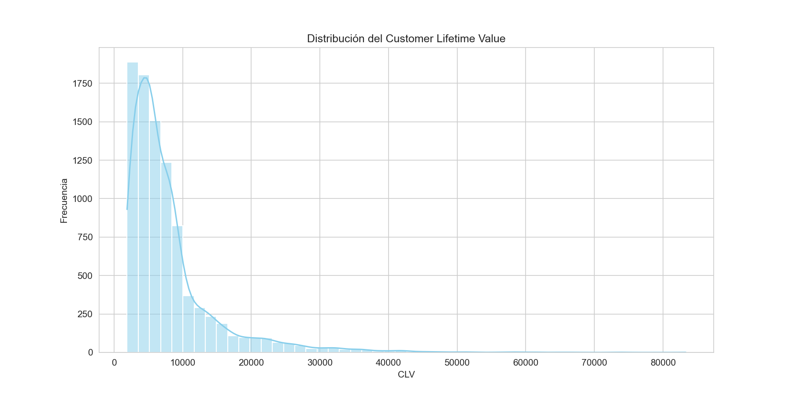
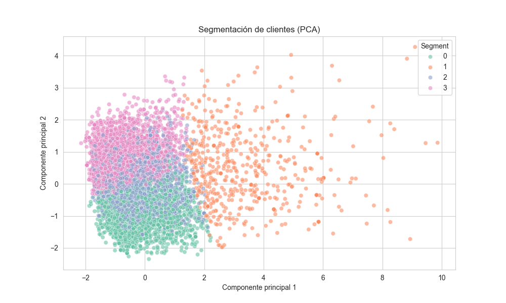
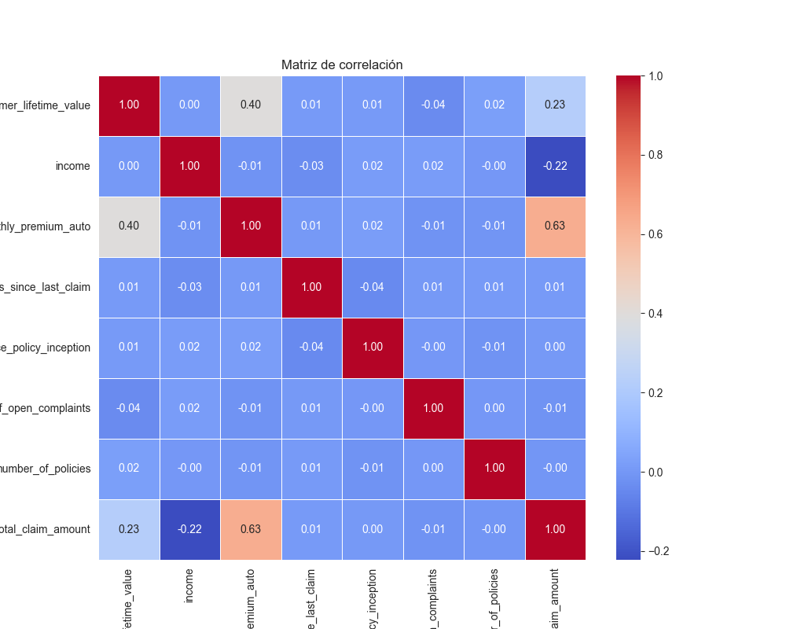
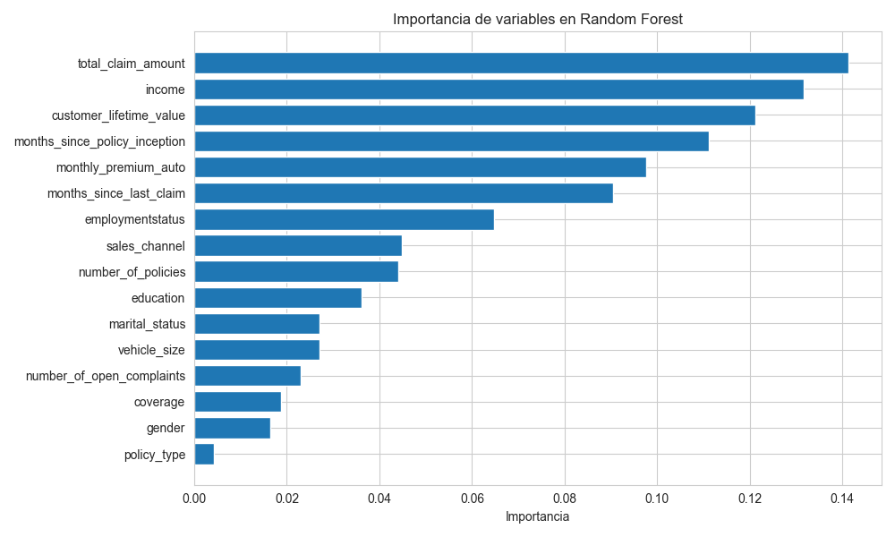

# Customer Lifetime Value Analysis


End-to-end customer analytics project for an auto-insurance portfolio: SQL exploration, customer segmentation and a predictive model for marketing-offer response, built around one business question: **which customers are worth the most, and which ones are likely to respond to an offer?**

---

## Why this project

Customer Lifetime Value (CLV) is one of the metrics that connects marketing, finance and strategy. A company that knows which customers generate the most value can price better, retain the right people and spend its acquisition budget where it pays back. I built this project to practice the full workflow a business analyst or consultant follows: query the data, understand it, segment it and turn it into a recommendation.

## Objectives

1. Load the raw dataset into a relational database and answer business questions with SQL.
2. Explore the drivers of CLV (coverage, income, policies, complaints, geography).
3. Segment customers into actionable groups with unsupervised learning.
4. Predict which customers respond to a marketing offer.

## Data

- **Source:** IBM Watson Marketing Customer Value Analysis (public dataset).
- **Size:** 9,134 customers, 24 variables (CLV, income, coverage, policy type, sales channel, claims, complaints and more).

## Methodology

| Step | What was done |
|---|---|
| Data cleaning | Column names normalized, zero incomes treated as missing, numeric types enforced |
| SQL layer | Data loaded into an in-memory SQLite database; six business queries run from `project_queries.sql` (CLV by state and coverage, response rate by education, CLV by income band, top customers, complaints vs CLV, responders by policy type) |
| Exploratory analysis | CLV distribution, CLV vs response, income vs CLV regression, CLV by state, correlation matrix |
| Segmentation | Standardized features, K-Means with the elbow method (k = 4), PCA projection to 2D for visualization |
| Prediction | Random Forest classifier (balanced class weights) to predict offer response, evaluated with classification report, ROC-AUC, confusion matrix and feature importance |

## Key findings

- Average CLV is about **8,005** with a median of **5,780**: a right-skewed distribution where a small group of customers concentrates a large share of the value.
- Coverage level is a clear value driver: average CLV grows from **7,191 (Basic)** to **8,790 (Extended)** and **10,896 (Premium)**.
- Only **14.3%** of customers responded to the marketing offer, so the classification problem is imbalanced.
- Four customer segments emerge with distinct profiles of value, income, premium and claims, which can be used to tailor retention and cross-selling.

**A note on model evaluation.** The Random Forest reaches a near-perfect ROC-AUC on a random train/test split. Instead of reporting that as a success, I investigated it: around 1,090 records share the same core numeric profile (CLV, income, premium and claims), which means near-duplicate customers can fall on both sides of the split and leak information. The honest next step is a de-duplicated or group-aware validation before trusting the score.

## Visuals

| | |
|---|---|
|  |  |
|  |  |

## Repository structure

```
customer-lifetime-value-analysis/
├── customer_analysis.py          # full pipeline: SQL, EDA, segmentation, model
├── project_queries.sql           # business questions answered in SQL
├── WA_Fn-UseC_-Marketing-Customer-Value-Analysis.csv
└── outputs/                      # generated charts
```

## How to run

```bash
pip install pandas numpy matplotlib seaborn scikit-learn
python customer_analysis.py
```

Charts are written to `outputs/`.

## What this project means for my development

This was one of my first projects joining SQL and machine learning in a single pipeline. It trained me to start from a business question rather than from a model, to translate query results into decisions, and, most importantly, to be skeptical of results that look too good. Detecting the leakage problem taught me more than any accuracy number would have. It fits directly into the profile I am building: a consultant who uses data and AI to support business decisions.

## Next steps

- De-duplicate records and use grouped cross-validation for an honest score.
- Estimate CLV with a probabilistic model (BG/NBD + Gamma-Gamma).
- Turn the segments into a retention and pricing playbook with expected financial impact.

---

**Author:** Tomás Alarcón, Systems and Computing Engineering, Universidad de los Andes
